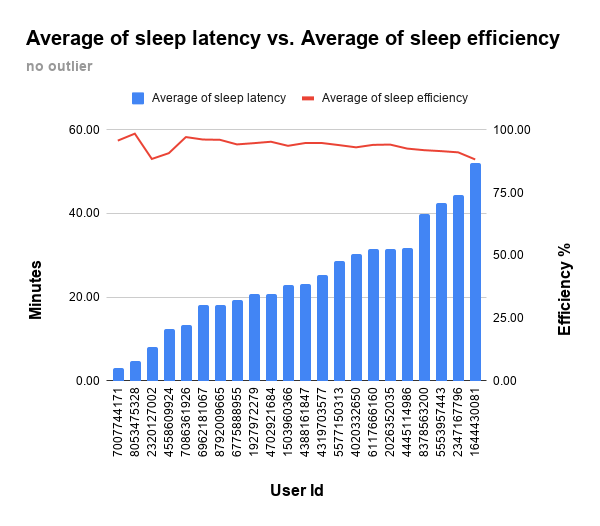
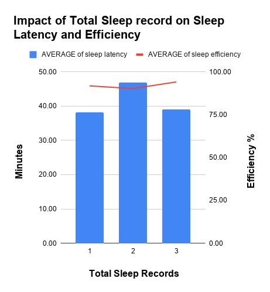
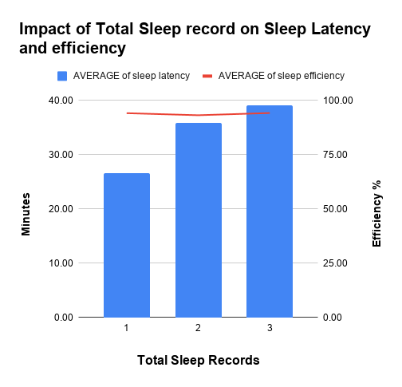
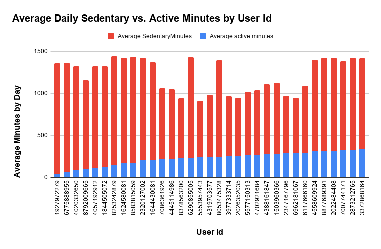
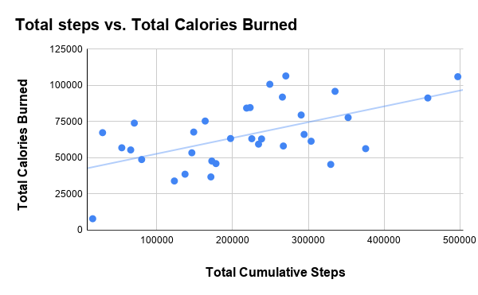
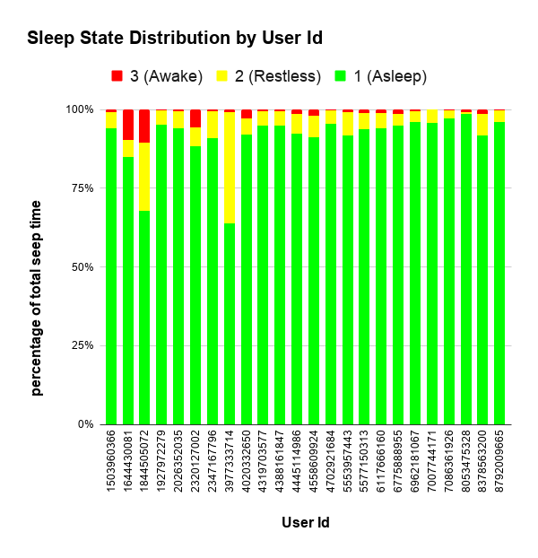
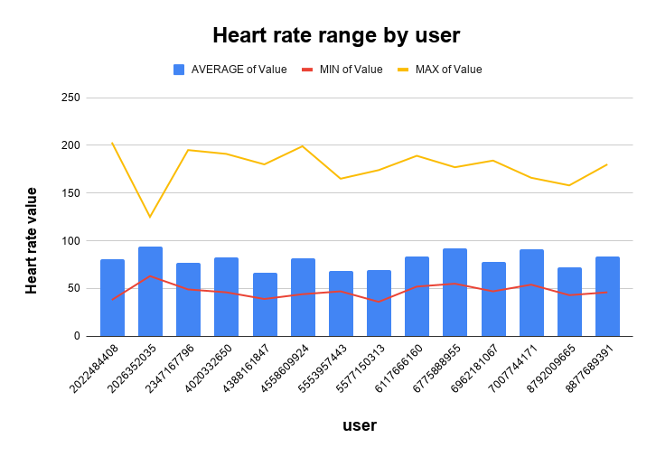
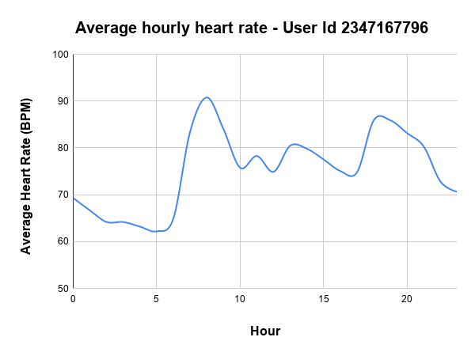
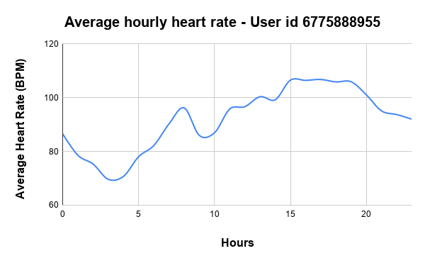

# Bellabeat Smart Device Wellness Case Study
A data analytics case study examining smart device usage patterns (activity, sleep and heart rate) to guide Bellabeat's product and marketing strategy with focus on a particular smart device. Built with spreadsheet.  
links: [explore the cleaned datasets and pivot tables in the /data folder](data/)  
links: [view all exported chart graphics in the /visuals folder](visuals/)
## 1. Executive Summary & Business Task
Bellabeat, a high-tech manufacturer of health-focused smart products for women, wants to unlock new growth opportunities. 
**Goal:** Analyze smart device usage data to identify trends in daily activity, sleep, and heart rate, and apply those insights to guide Bellabeat's marketing strategy.

---

## 2. Data Sources & Limitations
* **Dataset:** FitBit Fitness Tracker Data (CC0: Public Domain, via Mobius on Kaggle).
* **Scope:** 33 consenting users over a 31-day period, covering daily activity, minute-by-minute sleep logs, and 5-second interval heart rate records.
* ### Tables analyzed:
* Daily activity merged data
* Heart rate summary data
* Minute sleep_merged
* Sleep Day_merged 
* **Key Limitations:**
* Heart rate data is only available for a subset of **14 out of 33 users**.
* Demographic data (age, location) is omitted, requiring careful framing when applying findings to Bellabeat's female-focused customer base.

---

## 3. Tools
* **Spreadsheets (Google Sheets):** Data cleaning, deduplication, timestamp formatting, and pivot table aggregations and visualization.

---
## 4. Data Preparation  
* **DATA CLEANING:** Checked for duplicate rows, Fixed data types, Checked for missing data.
* **ANALYSIS: Calculated columns and Pivots**
* <ins>Daily activity merged - Calculated</ins>
* ***Total active minutes*** addition of very, fairly and lightly active minutes
* ***Ratio of active to sedentary minutes*** total active minutes divided by sedentary minutes
* ***Pivot 1*** summarized the table by Sum of Total steps and Sum of Calories burned of each user.
* ***Pivot 2*** summarized again by the Average of Total active and Sedentary minutes of each user.

* <ins>Heart rate summary data - Calculated</ins>
* ***Hour*** hour of the day each heartrate was measured, extracted from the date column
* ***Pivot 1*** summarized the table by the average, max and min value of the heartrate for each user 
* ***Pivot 2*** summarized by the average heartrate for each hour of the day for each user

* <ins>Minutes Sleep_merged - Calculated</ins>
* ***Pivot*** summarized by the percentage of sleep state for each user (1=asleep, 2=restless, 3=awake)

* <ins>Sleep Day_merged - Calculated</ins> (2 variants, one with complete data, other with outlier removed)
* ***Total Sleep Latency*** which is total time awake in bed. (Total time in bed - Total Minutes Asleep)
* ***Sleep Efficiency*** (Total time asleep divided by the Total time in bed multiplied by 100)
* ***Pivot 1*** summarized by the average sleep latency and average sleep efficiency for each user
* ***Pivot 3*** summarized by the average of sleep latency and average sleep against Total sleep record (1,2 and 3 fragments of sleep) 

---
                               
* ## 5. Key Findings
* _vs._Average_Sleep_Efficiency_by_user_Id.png)
* Lesser ***Sleep latency***, which is time spent awake in bed could be seen to cause a higher ***Sleep Efficiency*** and users with high sleep latency had a drop in their sleep efficiency.
* Last 2 user IDs had a very large sleep latency so they were treated as outliers.
* 
* The same chart with ***outliers*** removed, it could be seen that users with slightly elevated sleep latency still got a decent sleep with sleep efficiency above ***85%***
* 
* ***Total sleep record*** of ***2*** had the highest sleep latency and the lowest ***Sleep efficiency***. Total sleep record of 3 had almost the same sleep latency as 1 but it has the highest sleep efficiency.
* 
* With the ***outliers*** removed ***Total sleep record*** of ***3*** had the highest sleep latency and also the highest sleep efficiency.

  ---
  
* 
* **Sedentary Dominance:** Users spend the vast majority of their tracked time sedentary, directly correlating with lower sleep efficiency and longer sleep latency.
* 
* There appears to be a positive relationship between the ***total steps*** and the ***calories burned*** 
---  
  
* Higher percentage of the ***sleep state*** of the users shows they were asleep rather than awake or restless.

* ---
  
* Users had the same baseline or resting heartrate but with varied peak heartrates
* 
* ***Average_hourly_heart_rate_User_Id_2347167796*** shows the variation of heart rate for this user which the peak is below ***95BPM*** and it can be attributed to having  a low **sedentary minutes** from the Daily activity chart
* 
* ***Average_hourly_heart_rate_User_id_6775888955*** shows the variation of the heart rate for this user which the peak is above ***100BPM*** and could be attributed to having a high **sedentary minutes** from the Daily activity chart.  

## 6. Recommendations

Based on the activity, sleep, and heart rate patterns identified across tracked users, Bellabeat should focus on three high impact initiatives for the **Leaf tracker and Bellabeat App**:

1. **Position Bellabeat Around Personalized Baselines Rather Than Generic Targets**
* **Data Insight:** Intraday heart rate patterns differ noticeably across individuals (e.g., User **2347167796** stays below 95 BPM with lower sedentary time, whereas User **6775888955** sustains afternoon peaks above 100 BPM alongside higher sedentary minutes).
* **Action (Product & Marketing):** Calibrate stress and recovery alerts in the Bellabeat App to each woman’s personal resting baseline rather than a single universal threshold, and highlight *"wellness guidance tailored to your body’s unique rhythm"* across Bellabeat’s digital ad campaigns.

2. **Target Sedentary Working Routines with Micro-Movement Campaigns**
* **Data Insight:** Sedentary minutes dominate users' days even among participants who log regular active minutes while cumulative step counts correlate positively with total calories burned.
* **Action (Product & Marketing):** Introduce gentle midday movement nudges in the Bellabeat App during prolonged sitting stretches, and market the Leaf tracker as an effortless daily companion for busy, desk-based professionals looking to turn small movement breaks into measurable wellness wins.

3. **Promote Restorative Sleep Quality & Evening Wind-Down Habits**
* **Data Insight:** Higher sleep latency corresponds with lower sleep efficiency, while multi-session sleep logs (such as daytime naps or fragmented rest) impact overall sleep latency and efficiency differently than a single consolidated night's sleep.
* **Action (Product & Marketing):** Separate daytime naps from nighttime sleep scores inside the Bellabeat App, offer guided evening wind-down reminders when sleep latency rises, and center social media and video campaigns around helping women improve sleep efficiency not just total hours in bed.

---

## 7. Repository Structure
* `/data` — Cleaned datasets and summary tables.
* `/visuals` — Exported charts (Sleep Latency vs. Efficiency, Hourly Heart Rate Trends).
